# eForms Form 1 helper (suppressors, filed by a trust or by you as an individual)

Fills and submits ATF Form 1s in eForms for suppressors you make, either through your trust (it prepares the 5320.23
Responsible Person Questionnaire for each one) or as an individual. You stay in the loop: you log in, optionally type
your SSN, and enter the emailed code and your PIN for every submission.

> **Disclaimer.** Unofficial, provided as-is with no warranty, not affiliated with or endorsed by ATF. You are solely
> responsible for every application it files for you: each submission is your certification under penalty of perjury.
> Review what it fills, check ATF's eForms terms of use, and stop if anything looks wrong. It never asks for, stores or
> types your password, SSN, emailed code or PIN.

Currently supports: a trust with one or more responsible persons (U.S. citizens), or yourself as an individual
(U.S. citizen); suppressors (Form 1); on a Mac or Windows PC.

**Contents:** [What it looks like](#what-it-looks-like) ·
Getting set up: [Before you start](#before-you-start), [Get it](#get-it), [Install](#install-once),
[Your 5320.23 template](#making-your-532023-template-once-trusts-only),
[Other responsible persons](#other-responsible-persons-trusts), [First run](#first-run-check-my-setup-and-a-practice-run) ·
[Using it](#using-it): [Adding](#adding-and-editing-suppressors), [Filing](#filing), [Approvals](#checking-approvals),
[Inventory](#your-inventory), [Builds](#builds), [On your phone](#on-your-phone), [Advanced](#advanced) ·
[Your records](#your-records-and-where-they-live) ·
[Optional: an inventory server](#optional-an-inventory-server) · [Troubleshooting](#troubleshooting) · [License](#license)

## What it looks like
(Made-up serials, numbers and dates.)

**Home:** your queue and recent filings, and a menu.


**Add suppressors:** one, or a run of serials with the same caliber and length.


**File:** one confirmation for the whole batch, then each form is filled, read back and checked before it's signed.
You enter the emailed code and your PIN.


**Filing as an individual:** the same, without the 5320.23 and trust document. Your answers to questions 11.A-11.M
are shown in the confirmation, then read back on the verify page, with your citizenship, before it signs.

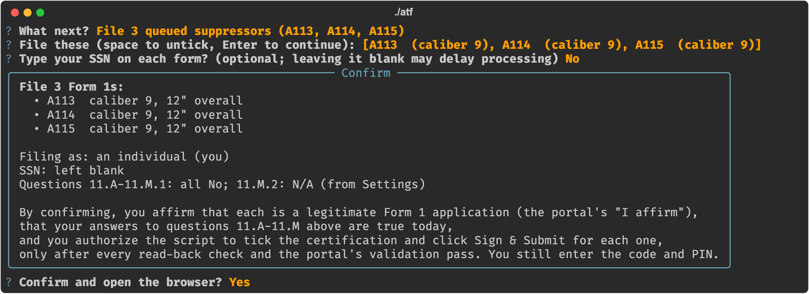
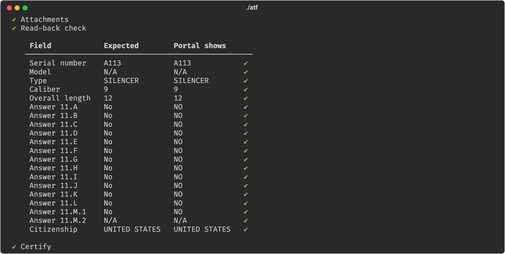

**Inventory** (suppressors and SBRs), **builds**, **Check approvals** (reads your approved Form 1s from eForms and
compares them with your records) and **Check my setup**. Your inventory on your phone is [further down](#on-your-phone).


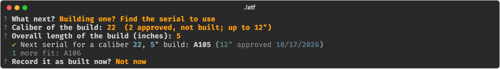
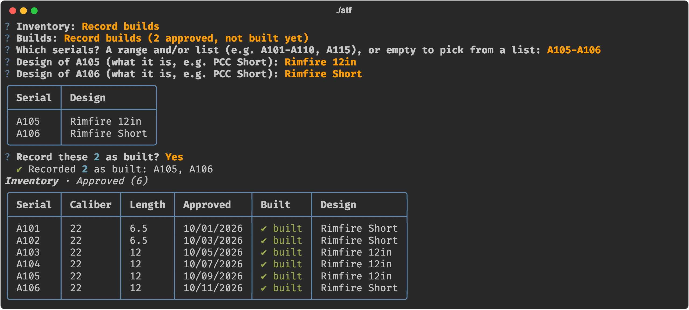

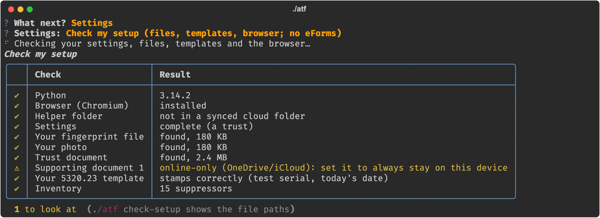

## Getting set up

### Before you start
- An eForms account, your fingerprint file (`.eft`) and a photo of you (JPG/PNG; eForms requires it).
- **Through a trust:** also your trust document (PDF) and **one signed 5320.23 template** (see
  [below](#making-your-532023-template-once-trusts-only)).
- **As an individual:** nothing else. Setup asks ATF's questions 11.A-11.M once (in ATF's own words) and saves your
  answers; they're filled in on each form, checked on the verify page, and shown for you to confirm before every
  batch. The helper only files when every answer is No (otherwise file that application yourself in eForms).
- **A trust with other responsible persons** (e.g. a co-trustee): each of them goes on every Form 1 with their own
  signed 5320.23 template, photo and `.eft` (see [Other responsible persons](#other-responsible-persons-trusts)).
- Optional: supporting documents for the firearm (e.g. photos of the tools/materials you'll use).

### Get it
- **With Git** (Mac: built in; Windows: install https://git-scm.com/download/win):
  `git clone https://github.com/SK360/eforms-form1.git` and later `git pull` (in that folder) to update.
- **Without Git:** download the ZIP of the latest release from https://github.com/SK360/eforms-form1/releases and
  unzip it. To update, download the new release and copy your `data`, `forms` and `out` folders into the new copy.

**Updates:** [CHANGELOG.md](CHANGELOG.md) lists what's new in each release, and the home screen shows which version
you have. To be told about new releases, choose **Watch > Custom > Releases** on the repository page.

### Install (once)
It needs Python 3.9 to 3.14 (3.13 recommended). A brand-new Python such as 3.15 doesn't have ready-built copies
of all the packages yet; the installer skips it and asks you to add 3.13 next to it.

**Mac** (Terminal, in the folder; macOS offers to install Python the first time if needed):
```bash
./install.sh
```
**Windows:**
1. Install **Python 3.13** (not the newest: 3.15 doesn't work with this yet, and it's what python.org's big Download
   button gives you now). Easiest way:
   - On https://www.python.org/downloads/ click Download to get the **Python install manager** and install it.
   - Open a terminal and run `py install 3.13`. Having 3.15 installed as well is fine; the installer below picks 3.13.

   (Or, from https://www.python.org/downloads/windows/, any 3.13 or 3.14 release that has a "Windows installer
   (64-bit)"; tick **"Add python.exe to PATH"** when installing.)
2. Put this folder somewhere outside OneDrive/Dropbox (e.g. `C:\Users\<you>\eforms-form1`): it will hold your
   personal records and a large browser profile that shouldn't sync.
3. In the folder, right-click > Open in Terminal, and run:
```
.\install.cmd
```

### Making your 5320.23 template (once, trusts only)
You make one signed 5320.23 with placeholder caliber and serial; for each suppressor the helper copies it, replaces
the caliber and serial, and stamps the date you file.

At https://jakepro716.github.io/atf-5320-generator/ fill in a **single form** (not the CSV/batch mode):

1. **Form:** ATF Form 1.
2. **Applicant:** your trust's name and address. **Responsible person:** your own details.
3. **SSN:** optional. Whatever you enter is printed on every 5320.23 made from this template (and kept in `out/`);
   leaving it blank is the more private choice.
4. **Photo:** skip it; it isn't needed on the PDF (your photo is uploaded to eForms separately).
5. **Firearm:** type silencer; maker = your trust's name and address; model as you'll set it in the helper (e.g. N/A);
   **caliber `00`** and **serial `TEMPLATE`**. Fill these in; don't leave them blank, the helper looks for them.
6. **CLEO:** agency, official's name and title, and the agency's full mailing address.
7. **Questions, citizenship, place of birth:** answer them truthfully; they carry into every filing unchanged.
8. **Sign, date it, download** the **ATF copy** (the 2-page questionnaire, not the CLEO copy).

On the first run of `./atf`, the helper asks for this PDF first (drag it into the window) and reads your answers
from it: trust name, date of birth, states, CLEO details and model come pre-filled, so you mostly press Enter (it
never reads the SSN). It also test-stamps the template: "✔ your 5320.23 template stamps correctly" means you're
set. Before your first filing, look at one result: Advanced > Regenerate a 5320.23 writes it to `out/`.

- Each filing re-stamps the signature date next to the signature you made once. If you'd rather sign fresh, remake
  the template in the generator before a batch (a couple of minutes), then in `./atf` choose Settings and answer
  **No** to "Keep your current 5320.23 template?".
- Remake it whenever something on it changes: your address, the model, the CLEO agency or address. (A new official
  at the same agency only needs Settings: the helper stamps the current official's name on every copy.)

### Other responsible persons (trusts)
eForms lists you (from your account) as the first responsible person. Everyone else your trust names as a responsible
person is added to each Form 1 with eForms' "Add Responsible Person", and each of them needs their own 5320.23.

1. Each of them makes **their own** template in the generator, the same way as yours (step list above) but with
   **their** details and the **CLEO where they live**, caliber `00`, serial `TEMPLATE`, signed by them.
2. In `./atf`, **Settings > Other responsible persons in the trust**, choose **Add a responsible person** and drag in
   their template. Their name, address, email, date of birth and state of birth are read from it (never the SSN);
   add their title in the trust, fingerprint file and photo. Change or remove them there too.
3. For each suppressor, their template gets the serial, caliber and filing date stamped like yours (their CLEO line
   is left as they made it). Make sure they agree to that, as you do for your own.

Filing then adds each of them on the responsible-persons page (typing their name and address, uploading their
5320.23, photo and fingerprints), reads the list back (their row is there, and nobody else), and the confirmation says
how many go on each form. If you choose to type SSNs, it pauses for each person's. It has been through a full
Practice run on the live portal, but not a real filing yet: do a Practice run (Advanced) first with your trust's
people and check their rows on the responsible-persons page.

### First run, Check my setup and a practice run
Start it with `./atf` on a Mac, `.\atf.cmd` on Windows (always with the `.cmd`).

The first run asks whether you file through a trust or as an individual, then for your details, CLEO and files
(Settings; change them any time, including switching between trust and individual).

Then run **Settings > Check my setup**: without opening eForms, it checks that your settings are complete, every
file (fingerprints, photo, trust document, supporting documents, each person's) is there, readable, the right kind and
not an online-only OneDrive/iCloud copy, that each 5320.23 template stamps correctly, and that the browser is
installed. Run it again whenever something changes. (`./atf check-setup` shows the same with the file paths.)

**Before your first real batch, do a practice run:** add a suppressor (a test serial like `TEST1` is fine), then
Advanced > **Practice run**. It fills a whole Form 1 in eForms and shows the read-back table, then stops: it never
signs or submits. Every row should have a ✔. Afterwards remove the test row (Edit or remove a queued suppressor) and
delete the draft in your eForms dashboard (drafts are also deleted after 90 days).

## Using it
Everything is in the menu (`./atf`). Questions that open the browser or file something take **y and then Enter** (a
key on its own doesn't count, so a stray keypress can't start anything). Ctrl-C is safe at any point: it logs you out
of eForms first (eForms allows one session at a time).

### Adding and editing suppressors
- **Add suppressors**: asks how many (Enter = 1), then the (first) serial, caliber and overall length, suggesting the
  next serial and your last caliber and length. For several, it numbers them in sequence (e.g. A101 … A110) with the
  same caliber and length, shows the range to confirm, and adds nothing if any of those serials already exist.
- **Edit or remove a queued suppressor**: fix a serial, caliber or length, or take it out of the queue. Filed and
  approved ones are your record of what was submitted, so they can't be changed here.

### Filing
- **File N queued suppressors**: pick the rows and say whether you want to type your SSN on each form. Trusts: it
  makes each suppressor's 5320.23, dated today. One confirmation lists the batch and says whether you're filing as
  your trust or as an individual (with your saved answers to questions 11.A-11.M); confirming is your "I affirm" and
  your OK to Sign & Submit each one once every check passes. A browser opens: log in (MFA included), wait for the
  eForms home page, press Enter; it checks you're really logged in before it starts. For each suppressor it fills the
  form, shows each page ticked off, waits for eForms to confirm your fingerprints ("Valid EBTS Package"), and shows a
  read-back table comparing what eForms will certify with what you meant (serial, model, type, caliber, length, and
  the trust name or your answers and citizenship). Only if everything matches does it sign; then a yellow **"Your
  turn in the browser"** box: enter the emailed code, Verify, enter your PIN, Submit.
- **⚠ Resolve a pending row**: only if a confirmation was missed. Check the eForms dashboard, then say whether it was
  filed.

### Checking approvals
- **Check approvals on eForms**: read-only. After you log in (and press Enter) it lists your approved Form 1s, saves
  each one's PDF to `out/approved/` (only new ones on later runs), reads the serial, caliber and overall length from
  each, and reports your suppressors: matching your records, differing (caliber/length), approved but not in your
  records, and filed but not approved yet. Approved SBRs go into a separate SBR inventory (`data/sbrs.csv`: caliber,
  model, barrel and overall length, approval date); other types are only counted. Approvals are recorded in your
  inventory, and it offers to add approved suppressors that aren't in it yet (e.g. ones you filed before using this
  tool).

### Your inventory
- **Inventory**: every suppressor in serial order (A1, A2 … A10) with caliber, length, status (queued, filed,
  approved), filed date, days waiting or approval date, and a ⚠ for approvals with conditions. **Show another view**
  filters by Approved / In progress / Queued / Built / Approved, not built, or shows your approved SBRs. From there you
  can also open any approved Form 1 PDF and **export to Excel** (`out/inventory_<date>.xlsx`, with an SBRs sheet). The
  home screen shows a one-line summary.

### Builds
- **Record builds** (in Inventory): mark approved suppressors as built, with what each one is. Name them as a range
  and/or list (`A101-A110, A115`) or tick them in a list; it then asks the design of each one (typed in, e.g. "PCC
  Short"), shows them all, and saves when you confirm. Only approved suppressors can be marked built. The design can
  be changed, or the build record cleared, later.
- **Building one? Find the serial to use**: pick the caliber (from your inventory) and type the overall length of what
  you're building; it gives the first approved, not built serial of that caliber approved at that length **or longer**
  (an approval for 12" is good for a 5" build), lists the others that fit, and can record it as built right there.
  Calibers match exactly (`.22` = `22`); approvals with no recorded length are left out and named.

### On your phone
**Inventory > Open on my phone** (or `./atf serve`) shows your inventory in your phone's browser. Nothing to set up:
the helper shows a QR code, you scan it with your phone's camera (on the same Wi-Fi), and the page opens.

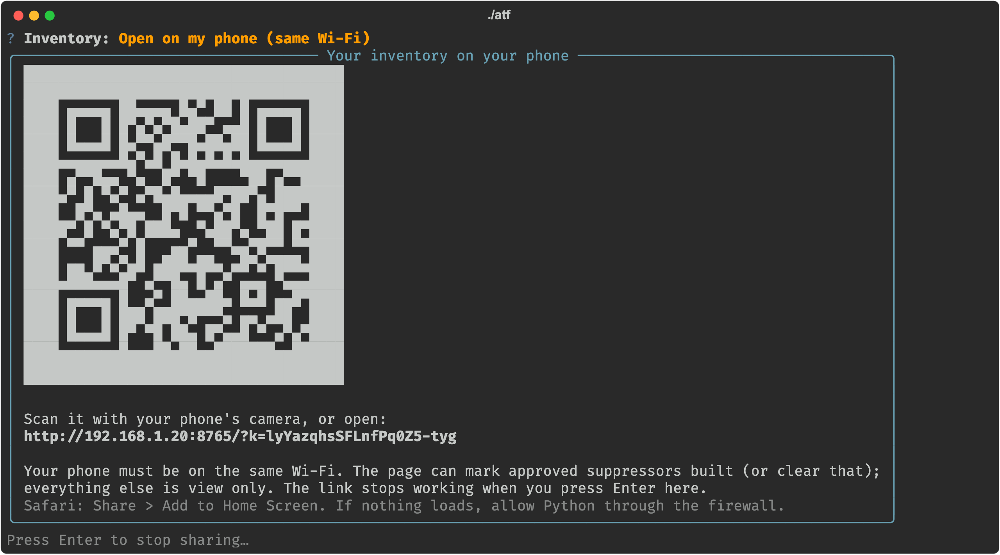

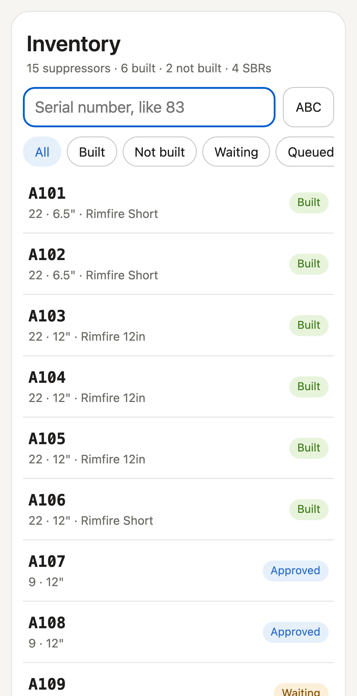 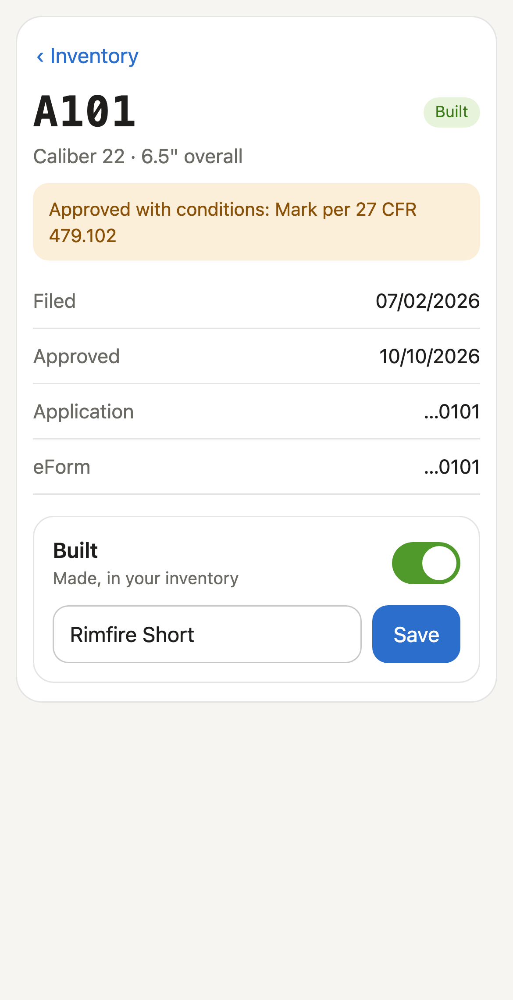

- Search by typing a serial's digits on the number pad (`83` finds A083), or switch to letters (ABC) to search by
  design; filter (All, Built, Not built, Waiting, Queued, SBRs); open one to see its details and its approval PDF.
- Switch **Built** on or off with its design, for walking through your safes and bags. That switch is the only thing
  the page can change, and only for approved suppressors.
- It works **only while you leave it open**: press Enter in the helper and the link stops working. Each time, the
  link carries a new key, so an old link or a photo of the QR code is no use later.
- It comes from your computer over your home Wi-Fi; nothing goes to the internet. If the phone can't connect, allow
  Python through your computer's firewall when it asks.
- On a wide screen (a tablet, another computer) the list and the details sit side by side. In Safari, Share > Add to
  Home Screen gives it an icon.

(If you'd like this page always available, on every phone, without the helper running: that's one of the things the
optional [inventory server](#optional-an-inventory-server) does.)

### Advanced
- **Advanced**: **practice run** (fills a form in eForms and stops before signing; nothing is submitted, the row
  stays queued); preview the steps without a browser; regenerate a 5320.23 with another date (trusts); re-file;
  capture portal pages if ATF changes the site.
- The plain command line is still underneath: `./atf fill-form1 --help` (Windows: `.\atf.cmd fill-form1 --help`).

## Your records and where they live
`data/suppressors.csv` is your inventory, one row per suppressor: caliber, serial, overall length, status, application
number, filed date, approval date, eForm ID, control number, any approval conditions, and whether it's built (with its
design). The app keeps it up to date; you can also open it in Excel (close it again before filing).
`out/submissions.csv` is a log of every filing.

Everything personal lives in `data/`, `forms/`, `out/` and `.browser-profile/` (your logged-in session), which are
never committed. **Never zip or copy this folder to share it**; share the git repository instead. (With the optional
[inventory server](#optional-an-inventory-server), your inventory and approval PDFs live on that machine, at home.)

## Optional: an inventory server
**Not needed, and most people won't want it.** Everything above works without it.

If you'd like your inventory in one central place on an always-on machine at home (a Proxmox container, Docker, any
Linux box), the helper can keep it on your own **inventory server** (a small database program you run yourself)
instead of in `data/suppressors.csv`. What you get: daily backups and restore, a history of every change (but never
when something was built), rules the database enforces itself, the same inventory on every paired phone and computer,
and its own always-on phone page. Filing and Check approvals still run on your computer, with extra safety checks;
your settings, templates and files never leave it. It works on your home network alone (no internet, no VPN needed),
you can try it with made-up data first, and you can move your inventory back at any time.

Why you might (or might not) want it and what it does: **[server/README.md](server/README.md)**. Installing it:
with **Docker Compose** on a NAS or any machine that runs Docker ([server/DOCKER.md](server/DOCKER.md)), or in a
**Proxmox** container ([server/LXC.md](server/LXC.md)).

### Connecting the helper
Settings > **Where your inventory lives** > Connect to my server: its address, a fingerprint to compare, a pairing
code. Then **Move this computer's inventory to the server** (**Try it first** changes nothing; moving only happens if
every field and every approval PDF arrives exactly). The home screen then says "On your server", and everything in the
menu works on the server's inventory. Switching back offers to copy the server's inventory to this computer first.

### The server's phone page
The server serves the same page as [On your phone](#on-your-phone), but **always**, at `https://<the server's
address>:8765`, for every phone you pair, whether or not your computer is on. It also shows each suppressor's history,
updates by itself when anything changes (on another phone or the helper), and has a Devices page. Set it up once per
phone:

1. **Open the address.** The first time, the browser warns that the connection isn't private (the server has its own
   certificate). On an iPhone: Show Details, then visit this website.
2. **Trust the server, once** (optional, but it stops that warning for good): open **Trust this server on this
   device** and follow it. Download the certificate. On an iPhone, Settings > Profile Downloaded > Install, **then
   turn it on** in Settings > General > About > Certificate Trust Settings > ATF inventory server CA (installing alone
   isn't enough). On Android, install it as a CA certificate under Settings > Security. Close the tab and open the
   address again.
3. **Pair it**: enter a 6-digit code made under **Devices > Add a device** on a phone that's already paired (or with
   `atf-server pair-code` on the server, for the first one). Give it a name you'll recognise.

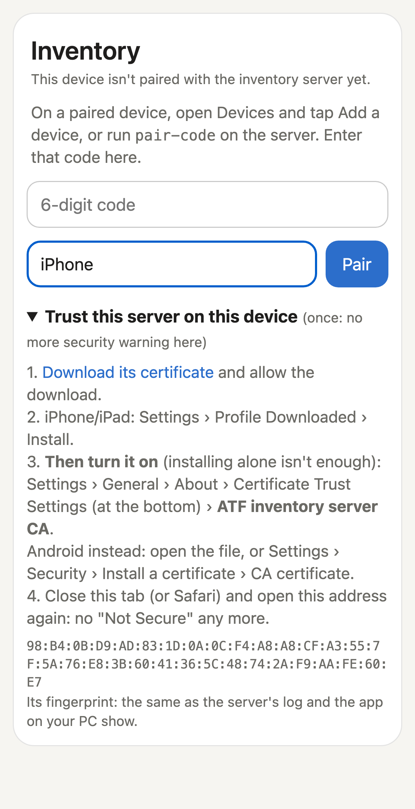 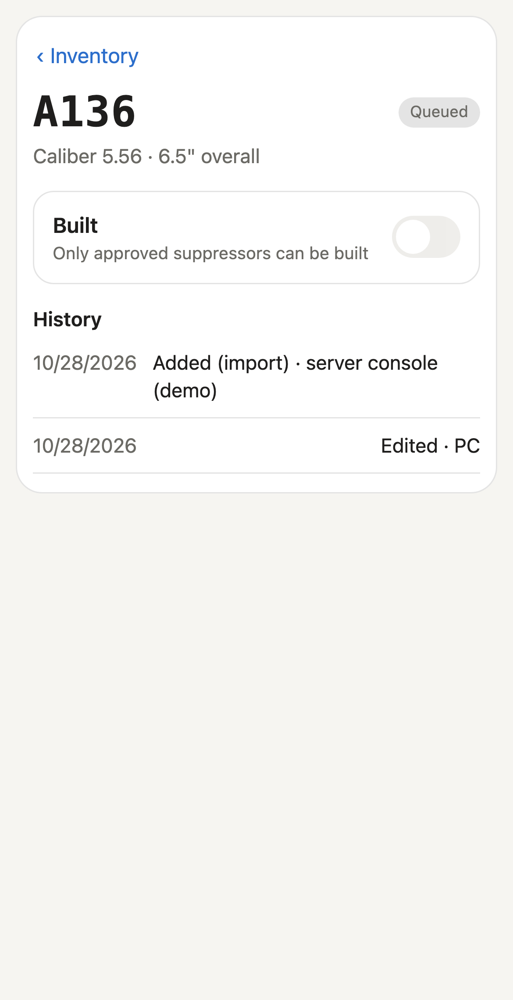 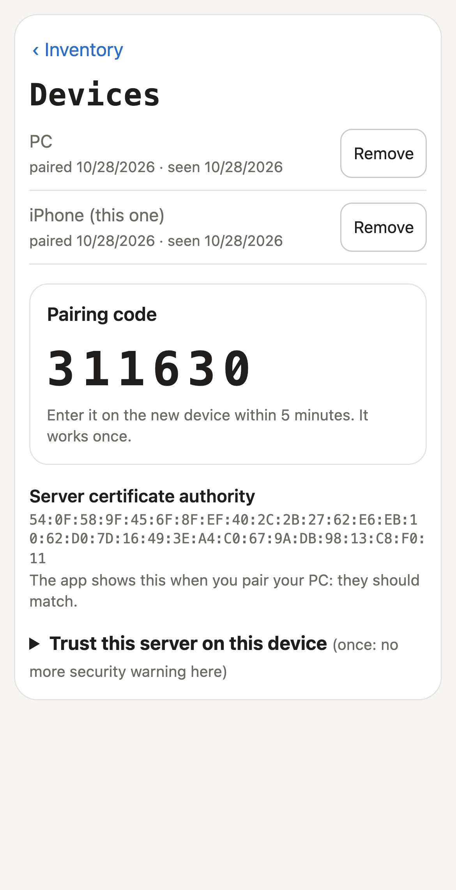

- **Devices** lists every paired phone and computer; **Remove** (tap twice) cuts one off at once, for a lost phone.
- A browser pairs per address: if you also reach the server another way (for example through your own VPN), pair
  there too.
- **History** lists what happened to a suppressor and from which device. When something was built is never recorded:
  only whether it's built, and its design.
- Away from home it works only if you add your own VPN; nothing needs one.

## Troubleshooting
- Start with **Settings > Check my setup**: most problems before a filing (a moved or online-only file, a template
  that doesn't stamp, a missing browser) show up there.
- "The browser isn't logged in to eForms yet": you pressed Enter before the login (MFA included) finished. Finish
  logging in until your eForms home page shows, then press Enter again (or type q to stop).
- "Another user is logged in": a previous run didn't log out; wait ~15-30 min or log out in the other browser.
- "no dialog said 'Valid EBTS Package'": eForms didn't confirm your fingerprint file within 60 seconds, so nothing is
  submitted. Check the message in the browser; on Windows, make sure the `.eft` isn't an online-only OneDrive file.
- A ✖ in the read-back table: eForms shows something other than what you meant, so it doesn't sign. Look at that
  field in the browser.
- A step fails: the browser stays open on that page; press Enter to log out. Check the eForms dashboard before filing
  that serial again. If ATF changed the site, the selectors in `config/mapping.yaml` need updating (see CLAUDE.md).
- Windows: if a step says a file is in use, close `suppressors.csv` in Excel and try again.
- Phone page from the helper doesn't load: same Wi-Fi? Allow Python through the computer's firewall.
- With an inventory server: [server/README.md](server/README.md) covers what happens when it can't be reached.

## License
MIT (see [LICENSE](LICENSE)): use, change and share it freely; it comes as is, with no warranty. The PDF library it
installs, PyMuPDF, has its own license (AGPL-3.0); that matters only if you bundle it into something you distribute.
