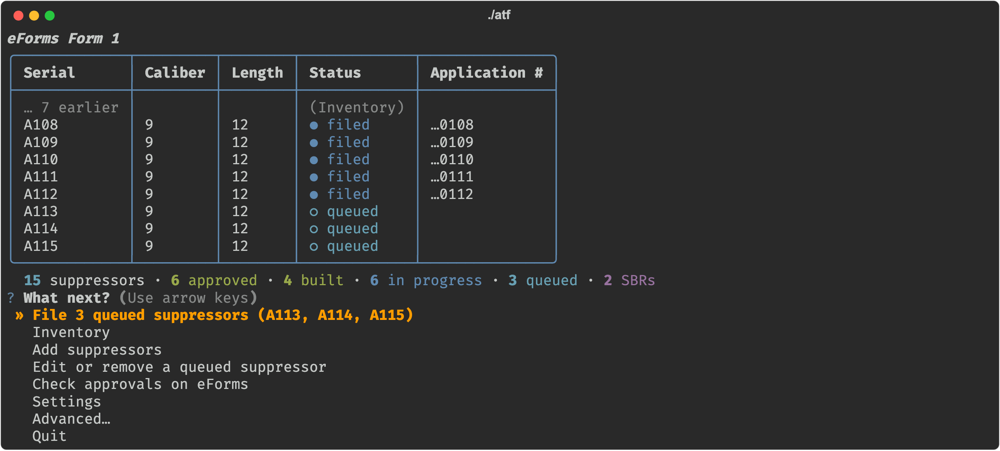
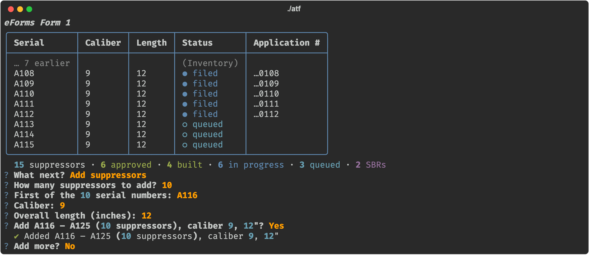
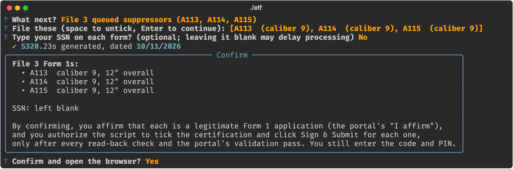
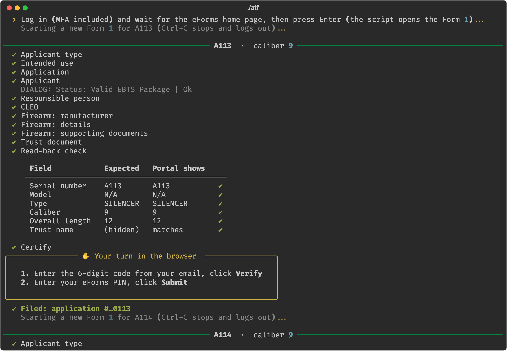
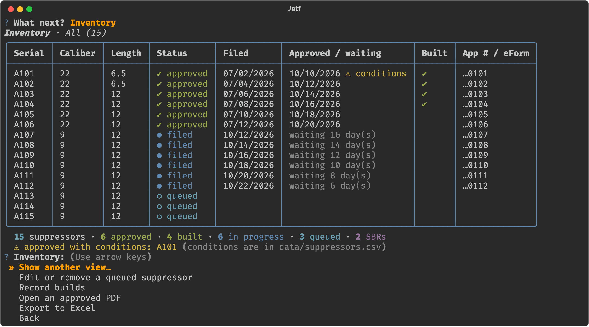
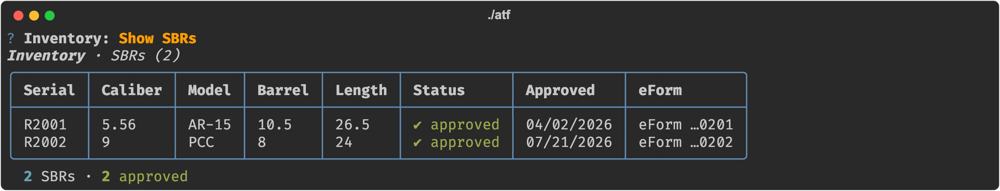
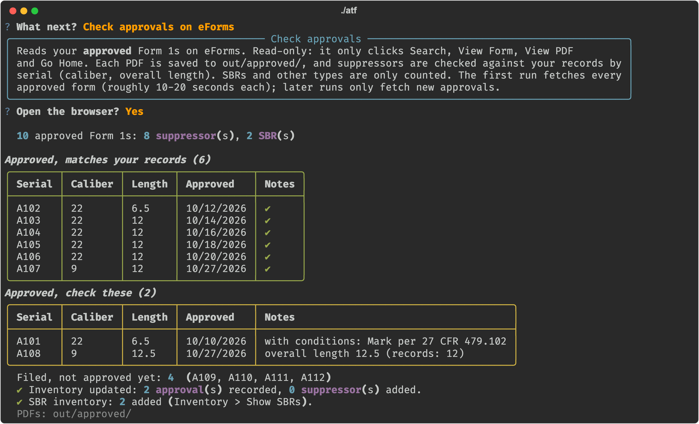

# eForms Form 1 helper (suppressors, filed by a trust or by you as an individual)

Fills and submits ATF Form 1s in eForms for suppressors you make, either through your trust (it prepares the 5320.23
Responsible Person Questionnaire for each one) or as an individual. You stay in the loop: you log in, optionally type
your SSN, and enter the emailed code and your PIN for every submission.

> **Disclaimer.** Unofficial, provided as-is with no warranty, not affiliated with or endorsed by ATF. You are solely
> responsible for every application it files for you: each submission is your certification under penalty of perjury.
> Review what it fills, check ATF's eForms terms of use, and stop if anything looks wrong. It never asks for, stores or
> types your password, SSN, emailed code or PIN.

Currently supports: a trust with one responsible person, or yourself as an individual (U.S. citizen); suppressors
(Form 1); on a Mac or Windows PC.

## What it looks like
(Made-up serials, numbers and dates.)

**Home:** your queue and recent filings, and a menu.



**Add suppressors:** one, or a run of serials with the same caliber and length.



**File:** one confirmation for the whole batch, then each form is filled, read back and checked before it's signed.
You enter the emailed code and your PIN.




**Inventory** (suppressors and SBRs) and **Check approvals**, which reads your approved Form 1s from eForms and
compares them with your records.





## Before you start
- An eForms account, your fingerprint file (`.eft`) and a photo of you (JPG/PNG; eForms requires it).
- **Through a trust:** also your trust document (PDF) and **one signed 5320.23 template** (see the next section).
- **As an individual:** nothing else. Setup asks ATF's questions 11.A-11.M once (in ATF's own words) and saves your
  answers; they're filled in on each form, checked on the verify page, and shown for you to confirm before every
  batch. The helper only files when every answer is No (otherwise file that application yourself in eForms).
- Optional: supporting documents for the firearm (e.g. photos of the tools/materials you'll use).

## Making your 5320.23 template (once, trusts only)
You make one signed 5320.23 with placeholder caliber and serial; for each suppressor the helper copies it, replaces
the caliber and serial, and stamps the date you file.

At https://jakepro716.github.io/atf-5320-generator/ fill in a **single form** (not the CSV/batch mode):

1. **Form:** ATF Form 1.
2. **Applicant:** your trust's name and address. **Responsible person:** your own details.
3. **SSN:** optional. Whatever you enter is printed on every 5320.23 made from this template (and kept in `out/`);
   leaving it blank is the more private choice.
4. **Photo:** skip it; it isn't needed on the PDF (your photo is uploaded to eForms separately).
5. **Firearm:** type silencer; maker = your trust's name and address; model as you'll set it in the helper (e.g. N/A);
   **caliber `00`** and **serial `TEMPLATE`**. Fill these in; don't leave them blank, the helper looks for them.
6. **CLEO:** agency, official's name and title, and the agency's full mailing address.
7. **Questions, citizenship, place of birth:** answer them truthfully; they carry into every filing unchanged.
8. **Sign, date it, download** the **ATF copy** (the 2-page questionnaire, not the CLEO copy).

On the first run of `./atf`, the helper asks for this PDF first (drag it into the window) and reads your answers
from it: trust name, date of birth, states, CLEO details and model come pre-filled, so you mostly press Enter (it
never reads the SSN). It also test-stamps the template: "✔ your 5320.23 template stamps correctly" means you're
set. Before your first filing, look at one result: Advanced > Regenerate a 5320.23 writes it to `out/`.

- Each filing re-stamps the signature date next to the signature you made once. If you'd rather sign fresh, remake
  the template in the generator before a batch (a couple of minutes), then in `./atf` choose Settings and answer
  **No** to "Keep your current 5320.23 template?".
- Remake it whenever something on it changes: your address, the model, the CLEO agency or address. (A new official
  at the same agency only needs Settings: the helper stamps the current official's name on every copy.)

## Get it
- **With Git** (Mac: built in; Windows: install https://git-scm.com/download/win):
  `git clone https://github.com/SK360/eforms-form1.git` and later `git pull` (in that folder) to update.
- **Without Git:** on the repository page (https://github.com/SK360/eforms-form1):
  Code > Download ZIP, then unzip it. To update, download it again and copy your `data`, `forms` and `out`
  folders into the new copy.

## Install (once)
It needs Python 3.9 to 3.14 (3.13 recommended). A brand-new Python such as 3.15 doesn't have ready-built copies
of all the packages yet; the installer skips it and asks you to add 3.13 next to it.

**Mac** (Terminal, in the folder; macOS offers to install Python the first time if needed):
```bash
./install.sh
```
**Windows:**
1. Install **Python 3.13** (not the newest: 3.15 doesn't work with this yet, and it's what python.org's big Download
   button gives you now). Easiest way:
   - On https://www.python.org/downloads/ click Download to get the **Python install manager** and install it.
   - Open a terminal and run `py install 3.13`. Having 3.15 installed as well is fine; the installer below picks 3.13.

   (Or, from https://www.python.org/downloads/windows/, any 3.13 or 3.14 release that has a "Windows installer
   (64-bit)"; tick **"Add python.exe to PATH"** when installing.)
2. Put this folder somewhere outside OneDrive/Dropbox (e.g. `C:\Users\<you>\eforms-form1`): it will hold your
   personal records and a large browser profile that shouldn't sync.
3. In the folder, right-click > Open in Terminal, and run:
```
.\install.cmd
```

## Use
Mac: `./atf`  Windows: `.\atf.cmd` (always with the `.cmd`)

The first run asks whether you file through a trust or as an individual, then for your details, CLEO and files
(Settings; change them any time, including switching between trust and individual). Then:

- **Add suppressors**: asks how many (Enter = 1), then the (first) serial, caliber and overall length, suggesting the
  next serial and your last caliber and length. For several, it numbers them in sequence (e.g. A101 … A110) with the same
  caliber and length, shows the range to confirm, and adds nothing if any of those serials already exist.
- **Edit or remove a queued suppressor**: fix a serial, caliber or length, or take it out of the queue. Filed and
  approved ones are your record of what was submitted, so they can't be changed here.
- **Inventory**: every suppressor in serial order (A1, A2 … A10) with caliber, length, status (queued, filed,
  approved), filed date, days waiting or approval date, and a ⚠ for approvals with conditions. Filter by Approved /
  In progress / Queued, or **Show SBRs** for your approved SBRs. From there you can also open any approved Form 1 PDF
  and **export to Excel** (`out/inventory_<date>.xlsx`, with an SBRs sheet). The home screen shows a one-line summary.
- **File N queued suppressors**: pick the rows, say whether you want to type your SSN on each form, confirm (this is
  your "I affirm" and your OK to Sign & Submit each one once every check passes). A browser opens: log in, wait for
  the eForms home page, press Enter. For each suppressor it fills the form, shows each page ticked off and a read-back
  table, then a yellow **"Your turn in the browser"** box: enter the emailed code, Verify, enter your PIN, Submit.
- **Check approvals on eForms**: read-only. After you log in it lists your approved Form 1s, saves each one's PDF to
  `out/approved/` (only new ones on later runs), reads the serial, caliber and overall length from each, and reports
  your suppressors: matching your records, differing (caliber/length), approved but not in your records, and filed
  but not approved yet. Approved SBRs go into a separate SBR inventory (`data/sbrs.csv`: caliber, model, barrel and
  overall length, approval date); other types are only counted. Approvals are recorded in your inventory, and it
  offers to add approved suppressors that aren't in it yet (e.g. ones you filed before using this tool).
- **⚠ Resolve a pending row**: only if a confirmation was missed. Check the eForms dashboard, then say whether it was filed.
- **Advanced**: preview the steps without a browser; a **practice run** that fills a form in eForms and stops before
  signing (nothing is submitted; the row stays queued); regenerate a 5320.23 with another date (trusts); re-file;
  capture portal pages if ATF changes the site.

Ctrl-C is safe at any point: it logs you out of eForms first (eForms allows one session at a time).

## Your records
`data/suppressors.csv` is your inventory, one row per suppressor: caliber, serial, overall length, status, application
number, filed date, approval date, eForm ID, control number and any approval conditions. The app keeps it up to date;
you can also open it in Excel (close it again before filing). `out/submissions.csv` is a log of every filing.

## Your data stays local
Everything personal lives in `data/`, `forms/`, `out/` and `.browser-profile/` (your logged-in session), which are
never committed. **Never zip or copy this folder to share it**; share the git repository instead.

## Troubleshooting
- "Another user is logged in": a previous run didn't log out; wait ~15-30 min or log out in the other browser.
- A step fails: the browser stays open on that page; press Enter to log out. Check the eForms dashboard before filing
  that serial again. If ATF changed the site, the selectors in `config/mapping.yaml` need updating (see CLAUDE.md).
- The plain command line is still underneath: `./atf fill-form1 --help` (Windows: `.\atf.cmd fill-form1 --help`).
- Windows: if a step says a file is in use, close `suppressors.csv` in Excel and try again.
